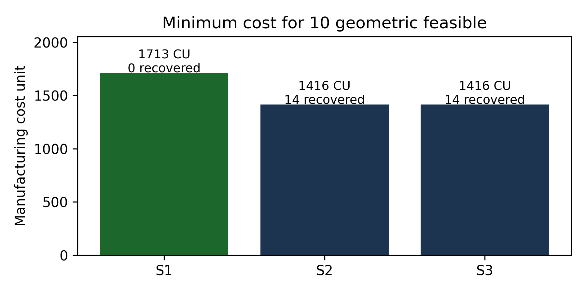
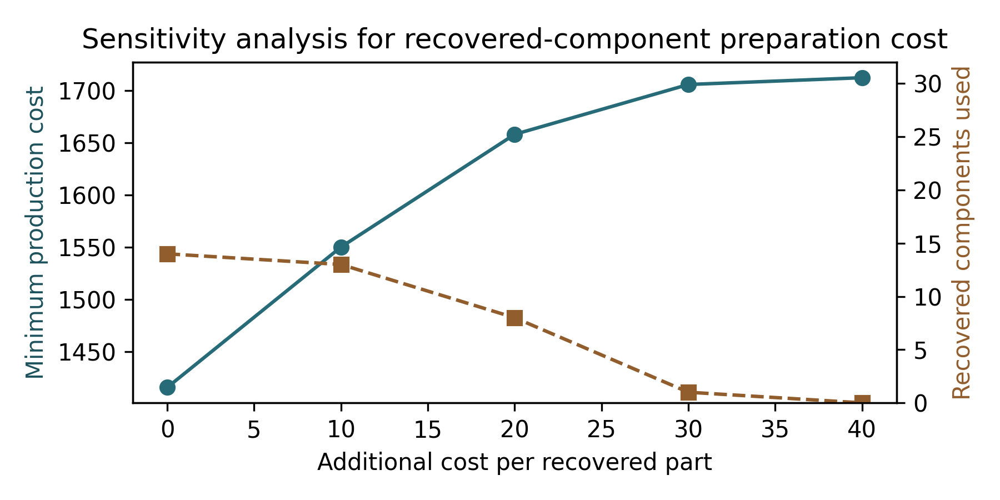
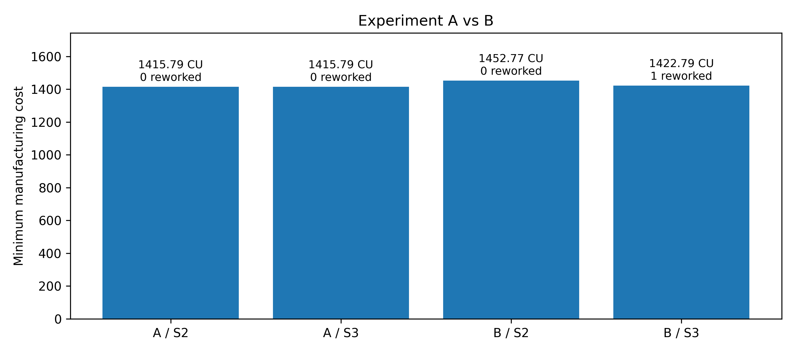

# Selective assembly of recovered hydrogen-valve components

A small optimization study motivated by high-pressure hydrogen valves. The question is simple: **if recovered parts are measured and screened, can we use them in precision assemblies at lower cost than buying everything new?**

I chose a representative **solenoid shutoff subassembly**—valve body, replaceable seat insert, and moving plunger/poppet—instead of modelling an entire tank valve. JTEKT's [on-tank hydrogen valve](https://www.jtekt.co.jp/e/products/hydrogen/valve01.html) is the product-level inspiration, **not the source of the dimensions or internal design**. The seat insert and its press fit are modelling assumptions, not claims about JTEKT hardware.

## The model

A valve body has a seat pocket; the seat insert fits in that pocket; the moving plunger must be able to reach the seat face. Two dimensional conditions are checked for every candidate triplet:

- **Seat installation:** `interference = seat outer diameter − body pocket bore`.
- **Closing reach:** `overtravel = plunger reach + installed seat height − body pocket depth`.

The overtravel is a **geometric proxy**, not a prediction of sealing force or leakage. We allow optional resurfacing of a *pre-screened, eligible recovered seat*, which reduces its height by 0, 0.015, or 0.030 mm. Only those fixed alternatives are considered.

Every measured dimension has a bounded error. A triplet is acceptable only if **both entire worst-case intervals** remain inside the assumed limits. The example limits (mm) are:

| Check | Permitted interval |
|---|---|
| Seat interference | 0.006–0.020 |
| Closing overtravel | 0.025–0.083 |

The model is a binary mixed-integer linear program (MILP):

\[
\min\sum_{(i,j,k,r)\in F} c_{ijkr}x_{ijkr}
\]

subject to **10 completed assemblies**, each physical part used at most once, and at most **3 resurfaced seats**. Candidate triplets outside the robust tolerance limits are removed before optimization. Costs include assumed acquisition/recovery and preparation costs, plus seat finishing when chosen. No separate reward for reuse is included; reuse is a result of cost minimization.

## Reproduce the study

Requires Python 3.10+.

```bash
pip install -r requirements.txt
python src/generate_data.py
python src/run.py
python -m unittest discover -s tests -v
```

The seeded data generator writes 10 new and 6 recovered parts of each type. One recovered part per type is excluded by a **hypothetical prior condition screen**, leaving 45 eligible components. Input measurements are in `data/`; all model parameters are in `config.json`. Outputs are in `results/`.

## Results (synthetic reference inventory)

| Policy | Cost (CU) | Recovered parts selected | Seats resurfaced |
|---|---:|---:|---:|
| S1: new only | 1712.53 | 0 | 0 |
| S2: new + recovered | 1415.79 | 14 | 0 |
| S3: new + recovered + resurfacing available | 1415.79 | 14 | 0 |



The **17.3%** lower cost of S2 relative to S1 comes from the assumed prices and compatible recovered inventory. Resurfacing does not help in this particular sample; allowing a process does not mean it must be used.

The most revealing check is to increase the recovered-part preparation cost without changing the measurements. As it rises, the optimizer selects fewer recovered parts; eventually the all-new solution becomes cheaper:



The numbers are **illustrative cost units (CU)**, not industrial quotes. This does not demonstrate real hydrogen-valve cost savings or leakage safety. In particular, recovered parts would require material, fatigue, sealing and hydrogen-compatibility assessments beyond this model. The press-fit seat design, axial tolerance limits, and resurfacing allowances need engineering validation for any real valve.

## Files

- `config.json` — numerical assumptions and experiment settings.
- `data/*.csv` — one synthetic inventory for bodies, seats and plungers.
- `src/generate_data.py` — regenerate the seeded inventory.
- `src/optimize.py` — compatibility screening and the MILP.
- `src/run.py` — three policies, one cost-sensitivity experiment, and plots.
- `results/` — a small summary, S3 selected triplets, and two figures.
- `tests/test_model.py` — checks geometry, uncertainty, eligibility, uniqueness and the solver.

**Next step with real data:** measure actual seat geometry and closure behavior, verify which components are legally and technically recoverable, and incorporate qualified functional test outcomes before optimizing production decisions.

## Experiment B: when seat resurfacing matters

A separate, deliberately constructed stress case changes **only the measured height of recovered seat `S-R-01`** from 2.994736 to 3.040000 mm. Every other measurement, price, tolerance, and production requirement remains unchanged. The original CSV files are not modified.

Run `python src/experiment_b.py` to compare the reference inventory (Experiment A) with this stressed inventory (Experiment B). In B, S2 costs **1452.77 CU** and uses 12 recovered parts. S3 costs **1422.79 CU**, uses 14 recovered parts, and resurfaces one seat (`S-R-01`) by 0.015 mm. That is a **29.98 CU** saving due to the added finishing option.



This is a *constructed example of when resurfacing becomes useful*, not evidence that recovered valve seats commonly have this deviation or that this saving would be achieved in industry.
